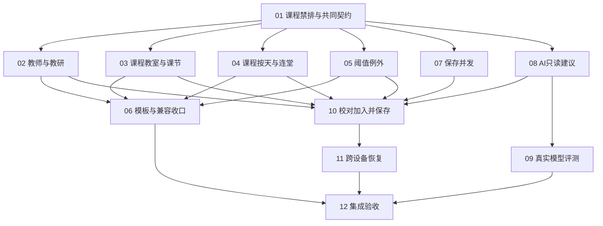

# 票14实现票据：12张端到端切片与阻塞关系

Status: ready-for-agent
日期：2026-10-27
阶段：用户明确答“可以的”，已确认12票粒度及依赖；正式票据已发布。本次发布不改变或关闭父票。

每票一个文件位于`issues/`，01–12均标ready-for-agent，并保留已批准编号、交付范围和阻塞关系。ready表示规格可执行，不表示阻塞前置已经完成。当前所有票尚未实现，未运行业务测试/模型评测或部署。

## 拆分与真实阻塞

| 票 | 交付 | Blocked by |
|---|---|---|
| [01 课程禁排首条纵向切片](issues/01-course-unavailable.md) | 手动多选星期/课节、要求分组、逐项控制、保存与各入口生效；兼容扩展共同契约和模板最小无损读取/写入。 | 无 |
| [02 教师与教研要求](issues/02-teacher-requirements.md) | 教师/教研5类各自设置必须或尽量，偏好时段保持任一命中，初中模式可编辑教研。 | 01 |
| [03 课程教室与课节要求](issues/03-course-slot-requirements.md) | 教室类型、晚自习、下午首节、上午优先、末节5类逐项控制及各入口一致。 | 01 |
| [04 课程按天与连堂要求](issues/04-course-aggregate-requirements.md) | 每日最多一节、连堂、分散3类逐项控制，按真实聚合事实去重计分。 | 01 |
| [05 阈值与对象例外](issues/05-threshold-requirements.md) | 5类阈值的数值/软硬一起替代全局，放宽明确确认，暂停例外回退全局。 | 01 |
| [06 模板及旧配置收口](issues/06-template-compatibility.md) | 全25类模板、旧格式与跨学期引用无损回归，收束兼容路径，六个单开关保留原义。 | 02、03、04、05 |
| [07 保存并发核对](issues/07-save-conflict-check.md) | 手工保存及模板套用共用配置版本，发现他人修改后保留本人的工作供核对。 | 01 |
| [08 AI只读建议与记录](issues/08-readonly-ai-proposals.md) | 最小生成页面、25类规范化与护栏、独立任务、60秒/无自动重试、取消/晚响应隔离及本人/管理员原始记录。 | 01 |
| [09 真实模型评测](issues/09-model-evaluation.md) | 22句各3次、52/54及12零误转、最多2模型/20元预算守卫、实测报告与模型选择。 | 08 |
| [10 校对、加入与统一保存](issues/10-confirm-and-save.md) | 补齐/选择/重复替换提示，保留手工修改后加入表格，统一版本保存，原话到最终变化审计。 | 02、03、04、05、07、08 |
| [11 跨设备未完成工作](issues/11-cross-device-workspace.md) | 按账号/学期恢复完整输入和修改，工作区版本防多设备覆盖，恢复重验引用及配置变化。 | 10 |
| [12 集成与验收收口](issues/12-integrate-and-accept.md) | 全25类、多入口、完整流程、权限/恢复/审计与实测证据核对，集中完整门禁及两轴评审。 | 06、09、11 |

## 为什么这样切

- 01先以一个可用的课程禁排流程完成共同契约的兼容扩展，不开一张纯数据库/纯后端基础票。其他旧族先维持原有行为，避免首票承担全部目录重写。
- 共同契约涉及广泛调用方，采用先扩展、按族迁移、最后收束兼容路径。02–05每票都同时覆盖表单、存取、求解、草稿/发布和调代/只读验证，不允许先做完页面再等末票补实际生效。
- 课程族分03的5类逐节/单事实匹配与04的3类按天/连堂聚合，避免8类混在一张大票中；02的教师可选集合和05的对象例外单独验收。
- 模板最小无损支持随01并在02–05逐族保持。06只做全目录收口和旧适配收缩，不能允许中间票静默丢分组或覆盖值。
- 07和08在01后可独立推进。08只读生成已能演示和固定响应验证；09紧随生成契约做真实评测，不把准确率问题拖到完整应用/恢复之后才发现。
- 10等全部可保存规则族、并发版本和生成契约就绪再打通确认闭环；不依赖09已评测通过才能用stub开发，但最终放行必须等09证据。
- 11一票完成完整未完成工作跨设备体验；前端/后端不水平拆开。审计在08生成、10保存、11恢复各自贯穿，不留到12补造关联。

## 验收场景责任映射

| 已确认场景 | 主要责任票 | 收口 |
|---|---|---|
| A01 帮填后统一保存、保留手工修改 | 10，前置07 | 12 |
| A02 同类不同软硬 | 02，01/03/04/05同族对照 | 12 |
| A03 逐项暂停及类型总开关 | 01–05 | 12 |
| A04 重要程度、继承与模板 | 01–06 | 12 |
| A05 同一限制重叠软硬去重 | 01–05各自匹配/聚合事实 | 12 |
| A06 阈值例外放宽全局 | 05，AI确认10 | 12 |
| A07 生效配置保存并发 | 07，应用10，恢复11 | 12 |
| A08 跨设备/账号/学期恢复 | 11 | 12 |
| A09 权限与完整追溯 | 08原始记录，10最终保存，11工作区隔离 | 12 |
| A10 重复/不兼容/替换 | 01–05手动校验，10AI新旧选择，06模板回归 | 12 |
| A11 部分转换与歧义 | 08只读，10补齐选择 | 12 |
| A12 取消与失败 | 08生成，10未保存，11恢复 | 12 |
| A13 多入口一致及旧配置 | 01–05逐族，06全目录模板/兼容 | 12 |
| A14 原话必须/尽量 | 08解析，10校对 | 12 |
| A15 编辑/重新生成不覆盖 | 08轮次，10应用，11恢复 | 12 |
| A16 60秒/无重试/晚响应 | 08 | 12 |
| A17 作息/引用变化复核 | 01–05手动，10加入/保存，11恢复 | 12 |
| A18 初中模式与AI不可用 | 01课程禁排，02教研，08AI状态，03–05逐项按需控制 | 12 |
| A19 模型实测与20元预算 | 09，生成边界08 | 12 |

C01–C22在08用确定性响应守规范化/护栏、09做真实模型评测、10验证校对/加入；01–05各自提供对应基础要求的手动等价场景。12只核对与集成回归，不首次实现这些行为。

## 执行边界

- 当前可起步的正式前置只有01；01完成后真正可并行前沿是02/03/04/05/07/08。共享文件意味着需要各自worktree并集中集成，不应把文件冲突误写成业务依赖，也不能在主仓库多会话互改。
- 每票只做定向测试和其用户可见E2E；每票自检后按实施方式安排独立评审。12在集成完成后只跑一次完整门禁和集成分支两轴评审，不让每票重复全量测试。
- 本次拆票发布不关闭或改写正式规格与父票。现有整本导入等其他未提交成果保留，实施时核对实际基点和迁移编号。
- 如09因价格不可靠、供应商不可用、预算耗尽或准确率未达标而阻塞，应留下可复查报告，12保持未达模型放行状态，不以开发完成冒充可用。
- 08规范化契约和固定语料需在09评测前锁定版本；10或后续若改变生成/规范化语义使实测证据失效，应在剩余20元总预算内重新验证或明确阻塞，不能新增未授权评测额度。

## 发布记录

2026-10-27，用户确认12票方案，全部从草案目录迁移到正式issues目录并标ready-for-agent。编号、交付与阻塞关系未改；依赖图、97条验收项和A01–A19责任映射已核对。尚未执行任何实现票；当前只有01没有阻塞，可作为起步票。
