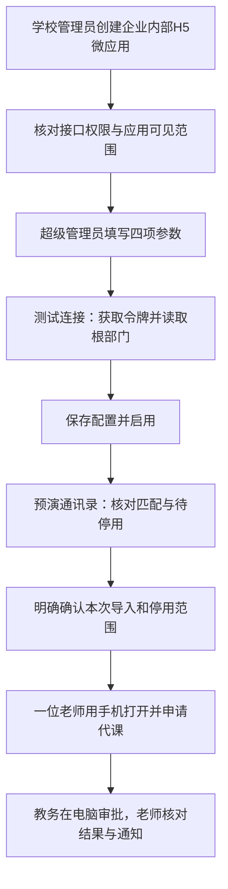
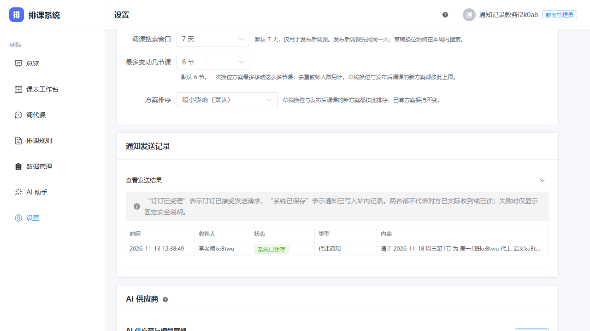

# 学校钉钉接入与实机验收

学校的超级管理员完成应用配置和通讯录确认，教务管理员负责排课与审批，老师在钉钉中打开应用。保留可用的 `admin` 密码账号，先验证它能登录，再接入钉钉。钉钉内需要密码入口时，在登录说明页选择“我是管理员，用密码登录”，或打开本校地址的 `/login?mode=password`。钉钉关闭时仍可使用系统本身。

本手册配合[部署手册](install-single-user.md)使用。上线前应已部署本批钉钉多用户功能，配置学校可访问且证书受信任的 HTTPS 地址。首次试用请先选少量老师，保留原有账号与课表。

## 1. 在学校所属企业创建应用

使用有企业应用管理权限的学校钉钉账号登录[钉钉开放平台](https://open-dev.dingtalk.com/)，先核对当前组织。创建企业内部应用，应用类型选择 **H5 微应用**、开发方式选择企业自主开发，填写学校应用名称、说明与图标。

[阿里云官方示例](https://help.aliyun.com/zh/document_detail/606946.html)中的导航为“应用开发 → 企业内部开发 → 创建应用”；后台版本可能不同，以学校当前页面为准。该示例面向其他产品，排课系统只参考其中的应用创建和凭证位置，不需要购买或配置其中的云桌面。

应用首页配置为本校排课系统 HTTPS 地址，并按学校当前后台要求配置相应域名、可信访问地址与服务器出口 IP。发布应用后，把试点老师加入可使用范围。不要把服务器内网 IP 当作出口 IP。

## 2. 核对权限与可见范围

接口权限和“谁能在工作台打开应用”分别核对。申请本应用实际使用的通讯录读取能力：读取部门、部门成员及成员基本信息；另开通工作通知发送能力。以当前后台权限说明及其关联 API 为准，不照搬其他产品所需的手机号、邮箱或人事权限全集。

- [获取部门详情官方说明](https://developer.alibaba.com/docs/api.htm?apiId=52330)：连接测试读取根部门。
- [工作通知官方说明](https://developer.alibaba.com/docs/api.htm?apiId=37692)：工作通知使用对应微应用的 `agent_id`。

把参与试点的老师及其部门纳入应用可使用范围与所需通讯录授权范围。根部门读取通过，仍需在本系统预演中检查实际能读到哪些老师；它不保证整校通讯录均可见。

## 3. 超级管理员填写参数

登录排课系统，打开“设置”中的“钉钉集成”。此区块只向持有集成配置权限的超级管理员显示，教务管理员和老师不能配置。

| 参数 | 从哪里取得、用于什么 |
|---|---|
| AppKey | 所选企业内部应用的凭证区域，用于获取应用访问令牌 |
| AppSecret | 与该 AppKey 配套的应用密钥；不要发到群聊、截图或工单里 |
| AgentId | 同一微应用的 ID，用于工作通知；不能用 AppKey 代替 |
| CorpId | 当前学校企业组织的 ID，用于钉钉 H5 免登；不能用 AgentId 代替 |

四项参数必须属于同一个学校组织和应用。事件令牌是另行接入增量事件转发时使用的校验值；它不是上述四项之一，也不是 AppSecret。没有部署事件转发时，不把填写该项当成已经订阅成功。

点击 **测试连接** 可以使用还未保存的 AppKey/AppSecret。测试不会保存参数、同步通讯录或发送通知。已保存密钥且 AppKey 没改时可留空复用保存密钥；改 AppKey 后必须输入与新应用匹配的密钥。

成功仅表示本次凭据能够取得访问令牌并读取根部门。它没有验证 AgentId、CorpId、完整可见范围、老师免登或工作通知送达。修改参数后应重新测试；确认本校参数后，打开“启用集成”开关并点击“保存钉钉配置”，再进行预演。保存时 AppSecret 留空会保留原密钥；更换应用时应一并填写新密钥。

本节应用截图将在本票真实浏览器验收后补入；当前不以示意图冒充真实界面或钉钉后台。

## 4. 先预演，再确认通讯录

保存并启用后点击 **预演同步**。预演只读取和分类，不立即修改账号或教师。核对新增、补齐、冲突、疑似同名与将停用名单；同名不明确时先排除或人工确认，不能仅凭姓名覆盖已有绑定。

确认导入前逐项检查“将停用账号”。停用只影响账号登录，不删除教师档案和课表；恢复需超级管理员在账号页重新启用。不要因为调整了试点可见范围，就把未出现在本次范围中的其他老师全部停用。通讯录读取不完整时系统不会生成停用名单，先处理读取问题后重做预演。

超级管理员明确选择这次需要导入、排除和停用的对象，再点击页面给出的确认按钮。有停用时还会出现二次确认。预演后外部通讯录可能变化，最终确认会重新检查，遇到冲突按新结果处理。

普通老师首次打开应用时，可以按可信钉钉 ID 或唯一未绑定同名教师匹配并创建免登账号；同名歧义会拒绝自动配对。**教师若关联已有管理员能力账号，首次钉钉绑定必须由超级管理员确认**，不能靠改姓名自行匹配。教师钉钉 ID 也仅超级管理员可改。教务可维护教师业务资料，不拥有身份绑定权限。

## 5. 一位老师与一位教务做实机验收

以下由学校在真实钉钉租户和手机上执行，逐项记录日期、操作者和结果。离线假钉钉、本地浏览器或“测试连接”成功不能替代本清单。使用不影响正式教学的测试安排，记录申请编号，不把真实密钥加入验收附件。

- [ ] 超级管理员仍能用 `admin` 密码登录；教务看不到账号管理、账号审计和钉钉配置。
- [ ] 试点老师从手机钉钉工作台打开学校应用，进入自己的账号与本人课表；姓名、教师档案和登录身份正确，没有绑定成管理员或另一位同名老师。
- [ ] 首次自动创建的账号为老师身份；再次进入复用该账号，没有重复教师/账号。关联管理员的教师先由超级管理员确认绑定，再进入。
- [ ] 在未来尚未开课的一节课申请代课，选定期望接课人。提交后显示待审批，课表没有提前改动。
- [ ] 独立教务账号在电脑待审批列表找到同一申请，核对原课、期望接课人；可改为另一位有空档老师后批准。
- [ ] 申请老师手机“我的调代”显示已生效，详情分别保留期望接课人与最终接课人；实际课表由最终接课人承担。
- [ ] 申请人收到批准结果；最终接课人收到包含日期、第几节、班级与课程的代课通知。被替换的期望人及无关老师没有收到这次代课通知。
- [ ] 另用独立申请验证驳回：必须填写理由，申请人看见已驳回及该理由。老师只能撤回本人尚待批的申请，开课后不能再批准。
- [ ] 如学校使用工作台直接调课，核对每位被挪动老师只收到自己的课换到哪里的通知；课表发布、班主任及教务抄送不再触发。
- [ ] 管理员在设置页发送记录中核对该申请的通知。钉钉已受理不等于老师已读；系统已保存表示本地留存，另由老师确认手机实际收到。
- [ ] 超级管理员核对账号审计，教务核对调代状态历史，申请人、批准人和最终接课人可追溯。

上图为本系统真实浏览器截图，使用本地 H2 与假钉钉演示数据，展示业务类型和“系统已保存”状态；不是学校租户或手机实际送达回执。学校须按自己的申请编号与老师反馈核对。

## 6. 遇到问题时

| 现象 | 建议检查 |
|---|---|
| 获取令牌失败 | AppKey 与密钥是否配套，密钥是否被重置；按安全提示处理，不直接认定所有拒绝都是密码错 |
| 无法读取根部门 | 应用通讯录授权、企业状态和出口 IP；官方文档中的60020对应IP白名单、90018对应限流，其他拒绝需按实际安全原因排查 |
| 网络或响应错误 | 服务器能否访问钉钉接口、代理与超时情况；不要反复点保存来“修复”测试连接 |
| 连接通过但手机免登失败 | CorpId、应用首页 HTTPS、应用使用范围、同名歧义、教师绑定与账号是否启用 |
| 连接通过但工作通知未到 | AgentId、工作通知权限、老师可见范围、发送记录状态，再由老师实机确认 |
| 老师账号被停用 | 超级管理员核对同步停用选择及审计，确认后恢复账号；开通排课资格不能替代账号重新启用 |

关闭钉钉集成可暂时停止相关接入，系统原有密码登录入口保留。涉及线上数据修改前，按部署跑册备份并记录范围；不要通过删除教师或课表来排查登录问题。
